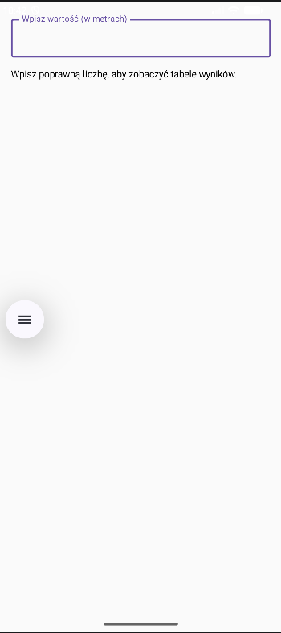
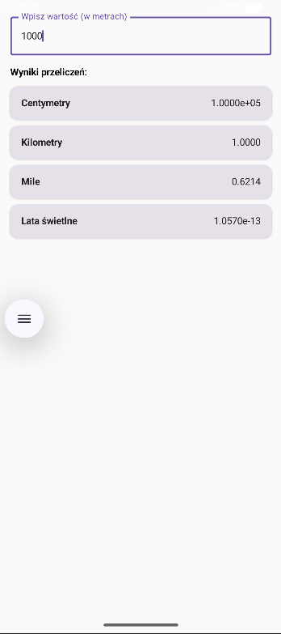
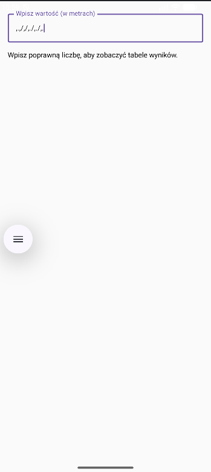
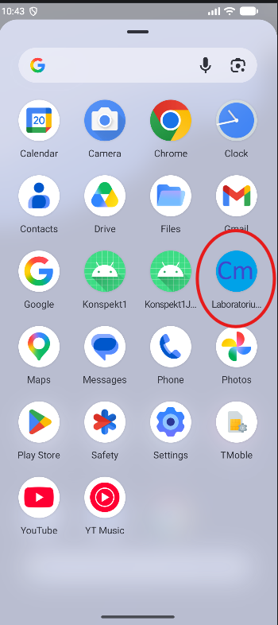
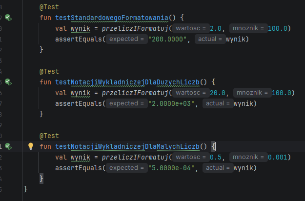

# Laboratorium 2 - Kalkulator Miar

Prosta aplikacja na system Android napisana w języku Kotlin z wykorzystaniem Jetpack Compose. Służy do przeliczania wartości z metrów na inne jednostki (centymetry, kilometry, mile, lata świetlne) w czasie rzeczywistym.

## 📸 Zrzuty ekranu aplikacji

Poniżej znajdują się wymagane zrzuty ekranu prezentujące różne stany aplikacji oraz wyniki testów.

### Stan pusty i Stan z wynikami
| Stan pusty | Stan z wynikami |
|:---:|:---:|
|  |  |

### Stan z błędnym wejściem i Ikona aplikacji
| Błędne wejście | Szuflada z ikoną |
|:---:|:---:|
|  |  |

### Wynik uruchomienia testów jednostkowych

---

## 📚 Zagadnienia teoretyczne

### Zachowanie blokady orientacji na telefonie i na tablecie
* **Telefon:** Blokada orientacji fizycznie blokuje ekran w wybranym układzie (np. pionowym). Aplikacja w ogóle nie zareaguje na obrócenie urządzenia do poziomu.
* **Tablet:** Na nowoczesnych tabletach (od Androida 12L) oraz urządzeniach składanych, system operacyjny często ignoruje twardą blokadę orientacji. Jeśli tablet jest trzymany poziomo, system wyświetli zablokowaną aplikację w wygenerowanym pionowym oknie na środku ekranu, dodając po bokach puste, czarne lub rozmyte pasy (tzw. *letterboxing*).
* **Wyjaśnienie różnicy:** Różnica ta wynika z priorytetów UX. Na małych ekranach telefonów priorytetem jest wola twórcy aplikacji. Na dużych ekranach tabletów priorytetem jest wielozadaniowość (np. praca na podzielonym ekranie, używanie fizycznej klawiatury), dlatego system unika inwazyjnego obracania całego środowiska.

### Co powinno zastąpić blokowanie orientacji?
Blokowanie orientacji na sztywno powinno zostać zastąpione **elastycznym interfejsem użytkownika** (tzw. *Responsive Design* lub *Adaptive UI*). Interfejs aplikacji powinien dynamicznie dostosowywać się do dostępnej przestrzeni i proporcji ekranu. Na przykład w Jetpack Compose można odczytywać wielkość okna (`WindowSizeClass`) i zmieniać układ elementów z pionowego na poziomy, gdy użytkownik obróci urządzenie.

### Krótkie uzasadnienie przyjętego sposobu formatowania wyników
W aplikacji zastosowano formatowanie warunkowe: standardowe wartości są formatowane jako ułamki do 4 miejsc po przecinku, natomiast wartości skrajnie małe (jak lata świetlne) oraz skrajnie duże wymuszają zastosowanie notacji wykładniczej (`e`). 
Takie podejście jest konieczne, ponieważ przeliczanie niektórych rzędów wielkości generuje ułamki z kilkunastoma zerami. Standardowe formatowanie spowodowałoby ucięcie istotnych cyfr (np. wygenerowanie samego `0.0000`) lub wypchnięcie tekstu poza widoczne krawędzie ekranu. Notacja wykładnicza gwarantuje, że wynik zawsze pozostanie precyzyjny i czytelny dla użytkownika, mieszcząc się w interfejsie.
